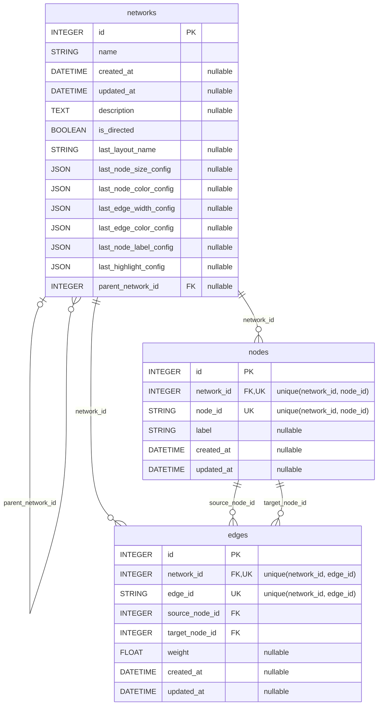
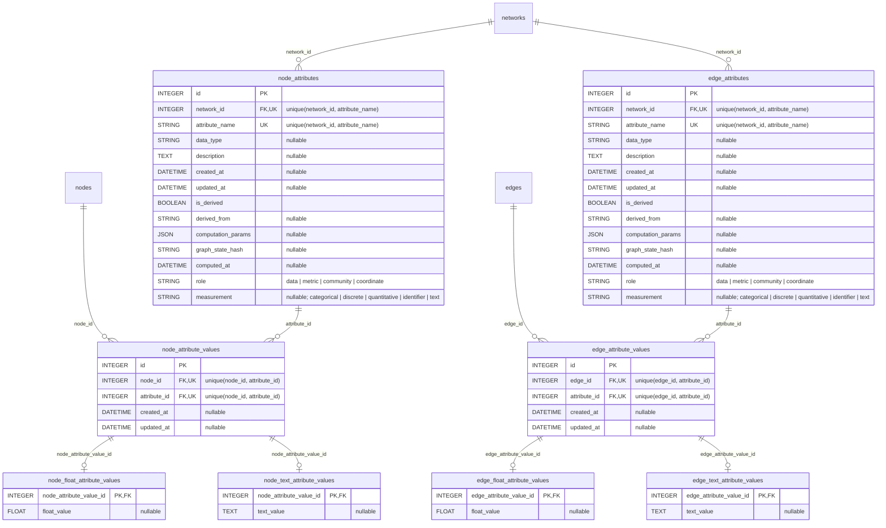
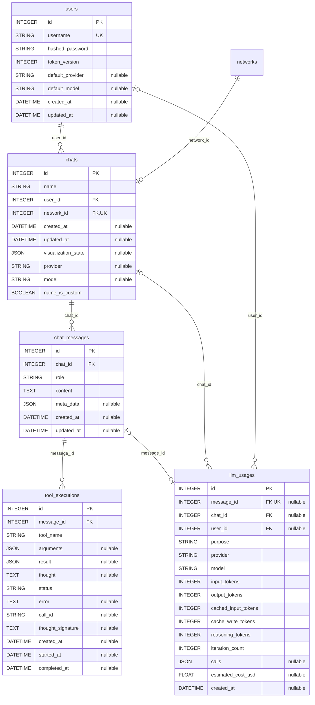
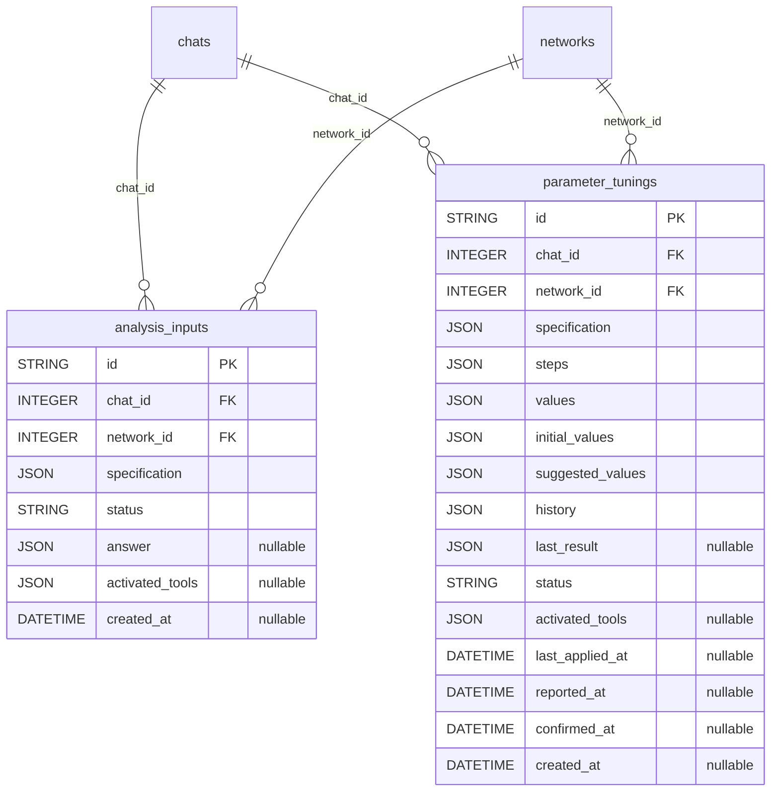

# データベーススキーマ（自動生成）

<!-- Generated by `python -m common.schema_doc` from common/models.py. Do not edit. -->

`common/models.py` から生成した列レベルの ER 図。**手で編集しない。**モデルを変更したら `backend/` で `python -m common.schema_doc` を実行する。設計の意図は [4_Database.md](../specification/2_Technical_Details/4_Database.md) にある。

列の注記: `nullable` は NULL を許す列、`unique(...)` は複合一意制約。他の領域のテーブルは、外部キーの参照先として列なしで描かれる。

## グラフ本体

ネットワークとその構造。サブグラフは親を指す独立したネットワークとして複製される。

## 属性

属性の定義（名前・型・意味・由来）と値。値は格納型ごとの子テーブルに分かれる。ノード側とエッジ側は同じ形をとる。

## 利用者と会話

利用者・チャット・メッセージと、エージェントの実行記録・トークン使用量。

## 会話中の入力

利用者への質問（ask_user）とパラメータ調整パネル。どちらも回答を待つ間、状態を保持する。

