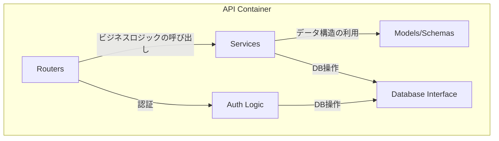
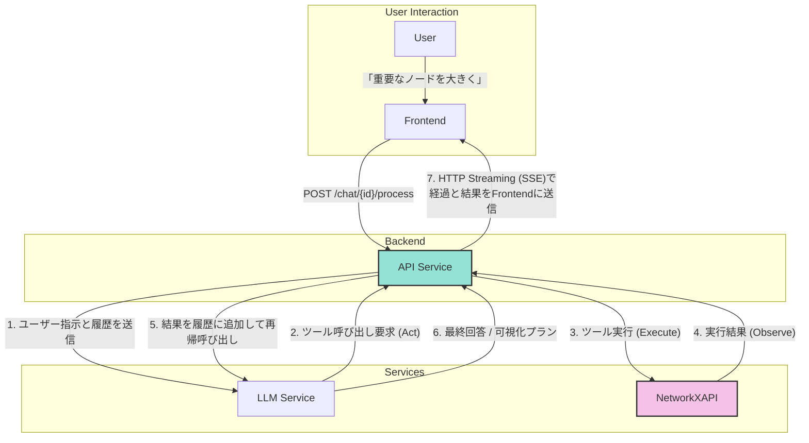

# 1. バックエンド仕様 (API)

**前提知識レベル:**

- FastAPI, Pydantic, SQLAlchemyに関する開発経験
- REST API, OAuth2, JWTに関する知識

FastAPIで構築されたバックエンドAPI。主な責務は、認証、ビジネスロジックの実行、外部サービス連携です。

## 1.1. コンポーネント図



| コンポーネント         | 説明                                                                      |
| :--------------------- | :------------------------------------------------------------------------ |
| **Routers**            | APIエンドポイントを定義し、リクエストを適切なサービスにルーティングする。 |
| **Services**           | ビジネスロジックを実装する。LLMサービス連携やNetworkXAPIの呼び出しなど。  |
| **Models/Schemas**     | Pydanticモデルとデータベーススキーマを定義する。                          |
| **Database Interface** | SQLAlchemyを使用してデータベースとのやり取りを抽象化する。                |
| **Auth Logic**         | OAuth2/JSON Web Tokenによるユーザー認証・認可のロジックを実装する。       |

## 1.2. API の設計方針

エンドポイントの一覧・シグネチャ・スキーマは FastAPI が実装から生成する。**唯一の情報源は `/docs`（OpenAPI）と `backend/app/api/` である。** ここでは、その形を決めている方針だけを述べる。

### 1.2.1. 分析操作は「チャットの所有権」で認可する

ネットワークとサブグラフは常に何らかのチャットに紐づく。ネットワークに対する操作の認可は、ネットワーク自身ではなく **そのネットワーク（またはその祖先）を保持するチャットの所有者であるか** で判定する。サブグラフは親を辿れるため、この一本の規則だけで階層全体の認可が閉じる。ネットワーク単位の ACL を持たないのはこのためである。

### 1.2.2. LLM 処理は受理と結果配信を分離する

対話処理の起動は即座に受理を返し、実際の応答・思考・可視化更新は SSE ストリームで届ける。LLM とツール実行の所要時間は事前に見積もれず、HTTP のリクエスト／レスポンスに載せるとタイムアウトと再送の設計が必要になるためである。

したがって **対話処理の HTTP レスポンスには結果が含まれない**。結果は必ずストリーム側に現れる。この非対称性がフロントエンドとの契約の中核であり、[2_Frontend.md](./2_Frontend.md) と [6_Core_Workflows.md](./6_Core_Workflows.md) で定義する。

### 1.2.3. サブグラフ操作は MCP ツールと REST の両方から届く

同じサブグラフ生成ロジックに、エージェント経由（MCP ツール）と直接操作（REST）の 2 つの入口がある。ロジックは `networkx-api/app/logic/` に一本化し、両者はその薄い入口として実装する。片方にしか存在しない機能を作らないこと。

#### 非同期契約の確認

対話処理の呼び出しは受理のみを返し、応答・思考・可視化更新は SSE ストリームに現れる。リクエストとレスポンスの正確な形は OpenAPI を参照すること。

この非同期のやり取りの全体像は **[6. 主要な処理フローとデータ生成](./6_Core_Workflows.md)** のシーケンス図で定義する。フロントエンドとバックエンド間の非同期通信については、この図が唯一の信頼できる情報源（Single Source of Truth）となる。

### 1.3. Backendの役割: LLMとツールのオーケストレーター

新アーキテクチャにおいて、Backendの役割はレンダリングデータを自ら組み立てることではなく、LLMと専門ツール（NetworkXAPI）間の指示を調整する**オーケストレーター（指揮者）**に特化します。

Backendは、ユーザーの入力に対して「思考(Think) → 行動(Act) → 観察(Observe)」のサイクル（ReActループ）を実行します。これにより、LLMはツール実行結果を見て次のアクションを決定できるため、動的柔軟な対応が可能になります。

#### データ変換フロー図



プロセスは以下のステップで実行されます。詳細は **[6. 主要な処理フローとデータ生成](./6_Core_Workflows.md)** の「6.13. LLMツール実行ループとコンテキスト管理詳細」を参照してください。

1.  **Thinking & Planning**:
    - Backendはユーザーの入力をLLMに渡します。
    - LLMはシステムプロンプトに従い、まず「何をするべきか」を思考し、必要なツール（`network_list_node_attributes` など）を選択します。

2.  **Tool Execution Loop**:
    - BackendはLLMが要求したツール（MCPツールまたはローカルツール）を実行します。
    - **Context Awareness**: 実行時に現在の `network_id` を自動的に注入します（PRE フックが担当。1.3.3 参照）。
    - **Verification First**: LLMは計算や可視化の前に、必ず `read_resource` や `network_list_node_attributes` を呼び出してデータの存在確認を行うよう指示されています。

3.  **Visualization & Response**:
    - LLMが `visualization_generate` を呼び出すと、NetworkXAPIがレンダリングデータを生成します。
    - Backendはこのデータを即座にSSEでクライアントにプッシュします。
    - 最後にLLMが生成したテキスト（考察や説明）をユーザーに送信します。

この設計により、Backendは視覚化の具体的なロジックに関与せず、LLMの知能とNetworkXAPIの計算能力を最大限に引き出すことに集中できます。


### 1.3.1. Context Injection Mechanism

LLMが「現在のネットワーク状態」を正確に把握し、効率的にツールを選択できるよう、Backendは独自の**コンテキスト注入メカニズム**を実装しています。

- **概要**: ユーザーの各メッセージの直前に、現在のネットワークのメタ情報（ID, ノード数, エッジ数, 利用可能な属性リスト）を自動的に挿入します。
- **目的**:
  1.  **Verification Firstの高速化**: 属性リストが既に提示されているため、単純な可視化指示であれば `read_resource` による確認ステップをスキップ可能にします。
  2.  **ハルシネーション防止**: 存在しない属性を使用しようとするLLMのミスを防ぎます。
  3.  **状態追従**: サブグラフへのコンテキスト切り替えが発生した場合でも、次のターンで最新のサブグラフ情報が注入されるため、LLMは常に正しい対象を分析できます。

**注入される情報の例:**

```text
[Current Network Context]
Network ID: 5
Stats: 150 Nodes, 300 Edges
Available Node Attributes:
- department (string)
- tenure (integer)
```

### 1.3.2. Skills (手続き知識の外部化)

エージェントの振る舞いに関する指示は、性質によって置き場所を分ける。

| 種別 | 置き場所 | 適用 |
|:---|:---|:---|
| 常に真である方針（役割・目的のある符号化・ユーザー主体性・ツール実行規則） | `app/services/llm/prompts.py` | 毎ターン |
| 手続き知識（分析の進め方・可視化の割り当て方・レイアウト調整・エラー回復） | `app/services/llm/skills/definitions/*.md` | 必要時のみ |

**動機**: 以前は `prompts.py` が「部分グラフ作成戦略」「レイアウトのチューニング
パラメータ一覧」といった手続き書を、リクエストの内容に関係なく全量注入していた。
ノード数を尋ねるだけの質問でも全ての手順書が送られていた。

**プログレッシブ・ディスクロージャ**:
1. システムプロンプトにはスキルの**索引**（名前と1行説明）のみを載せる。
2. モデルは `skill_load(name)` ツールで必要な手順書の本文を取得し、そのスキルの
   `related_tools` を同じターンの次回モデル呼出しから利用可能にする。
3. `TURN_START` フックがユーザー発話とスキルの `triggers` を突き合わせ、
   関連しそうなスキル名を1行だけ示唆する。索引は常に存在するので、キーワードが
   外れてもモデルは自力で選べる（示唆は誘導であって門番ではない）。
4. スキルが対象としない機能は `tool_search` で全ツールカタログを検索し、結果に
   含まれる定義だけを同じターンの次回モデル呼出しから利用可能にする。

MCP の全定義は Backend のキャッシュに保持するが、既定ではモデルへ一括送信しない。
各ターンの初回に公開するのは `skill_load`、`tool_search`、`ask_user` のみで、公開集合は
ターン内で増加し、次のユーザー発話ではリセットされる。並行するチャット間で公開状態を
共有しない。`TOOL_EXPOSURE_MODE=all` は比較と切り戻しのため従来の全件送信に戻す。

**例外は `ask_user` の回答**（ADR 0014）。質問はターンを終わらせるが、回答は同じ作業の
続きなので、質問時点の公開集合を質問の行に保存し、回答から再開するターンで復元する。
これがないと、方針を提案して尋ねるという主動線を通るたびにスキルの読み直しが要る。
カタログから消えた名前は復元時に落とし、「読み直しが要る」に退化させる。

未公開ツールの呼出しは `PRE_TOOL` ガードが保留し、検索またはスキル読込を案内する。
同一モデル応答内でスキル読込と関連ツールをまとめて要求しても、後者は遡って公開済みとは
扱わない。これにより、実際にモデルへ提示した定義だけが実行可能になる。

有効範囲はモデルが読む4箇所（`skill_load` / `tool_search` の返り値、両ツールの説明、
システムプロンプト、ガードの保留理由）で同じことを述べる。「有効化した」とだけ書いて
範囲を書かないと、モデルは質問を挟んだ後も使えるのかを判断できない。

**効果**: 常時送られるプロンプトは索引の分だけに縮み、手順書は総量を増やしながら
必要なターンでのみ読み込まれる。プロンプトの分量と手順書の充実がトレードオフで
なくなることが、この分割の眼目である。

**スキルの定義形式**: Markdown + 最小限の frontmatter（`name`, `description`,
`triggers`, `related_tools`）。`definitions/` に置けば自動的に検出される。
`triggers` には**日英両方**のキーワードを必ず含める。本アプリの利用者は日本語を
書くため、英語のみの trigger リストは日本語リクエストから不可視になる
（`tests/test_skills_loader.py` がこれを検査する）。

frontmatter のパーサは意図的に最小で、スカラーと文字列リストのみを解釈する。
仕様書やビルドに YAML の依存を持ち込まないためであり、それ以上の構造が必要に
なった時点で、その情報は frontmatter ではなく本文に書くべきものである。

現在存在するスキルは `app/services/llm/skills/definitions/` を参照すること。

#### レイアウトの skill は共通とアルゴリズム別の二層にする

レイアウトの手順は、共通の `layout` とアルゴリズム別の `layout-<登録名>` に分ける
（ADR 0017）。共通側は計算と描画の二段階、`layout_profile` によるアルゴリズム選択、
重みの読み方、`layout_quality` の読み方、改善ループを持つ。アルゴリズム別の skill は、
相互作用する調整パラメーター（`knobs`）か事前の手順を持つものにだけ作る。
circular や random のように戦略が無いものに作っても説明文の重複と索引行が増えるだけで、
逆に共通 skill 一本では使わないアルゴリズムの戦略まで毎回読み込まれる。

「もう少し広げて」のようにアルゴリズム名を含まない依頼では、アルゴリズム別 skill の
トリガーは一致しない。そのため `layout` が候補に出たターンでは、表示中のネットワークの
`last_layout_name` に対応する skill も候補に加える。対応は skill の `related_tools` に
含まれる `layout_<名前>` で引き、別の対応表は持たない。

skill はパラメーターの意味や数値を書かない（意味はツールの `Field(description=...)`、
数値は各レイアウトの宣言が持つ）。書くのは調整の順序と相互作用だけである。
`tests/test_skills_loader.py` が、数字の混入と、ツールに存在しないパラメーター名を検出する。

#### 描画直後に調整の進め方を尋ねる

エージェントが力学レイアウトを自動の初期値で描いたとき、そのチャットでこのネットワークに
初めてレイアウトを実行した場合とアルゴリズムを変えた場合に限り、「おまかせで調整／
今の値から自分で調整／このままでよい」を尋ねる（ADR 0018）。値ではなく進め方の選択で
あるため、0016 の「パラメーター値は質問しない」とは衝突しない。

促しは NO_TOOL_CALLS フック `nudge_layout_choice` が1ターン1回行い、同じレイアウトに
対する調整パネルの促しに代わる。スキルの記述だけでは小さなモデルが締めの文で終えて
しまうため、0016 と同じくフックで強制する。「初めて」は保存済みのツール実行で判定する。
ツール実行はターンの終わりに保存されるので、その時点の記録はすべて前のターンのもので
あり、アップロード時の自動レイアウトはツール実行として残らないため数に入らない。

回答は次のターンで届く。各選択肢の手順は `layout` スキルが持ち、選択肢の文言を
トリガーに含めて回答のターンでも候補に出るようにしている。

### 1.3.3. Hooks (実行時の強制と副作用)

プロンプトの文章は無視され得る。安全上の制約と副作用は、エージェントループの
各点で発火する**登録式フック**として機構化する（`app/services/llm/hooks/`）。

| イベント | 発火点 | できること |
|:---|:---|:---|
| `TURN_START` | 最初の generate() 前に1回 | システムプロンプトへのブロック追加 |
| `PRE_TOOL` | 全ツール呼び出しの直前 | **許可 / 引数の修正 / 保留 / 拒否** |
| `POST_TOOL` | 呼び出し成功後 | 描画、表示ネットワークの切替 |
| `TOOL_ERROR` | 失敗または拒否の後 | ターンの中断 |
| `NO_TOOL_CALLS` | ツールを呼ばずに終わろうとした時 | もう1周の要求 |
| `TURN_END` | ループ終了後に1回 | ターン集計のログ出力 |

**優先度帯**（昇順に実行）:

```
10-39  normalize     引数の書き換え
40-69  guards        検証と拒否（修正後の引数を見る）
90-100 audit         集計とログ
```

順序は本質的である。ガードは正規化後の引数を検証しなければならない。

**拒否の意味論**: `PRE_TOOL` が `deny` を返した場合、エンジンはツールを呼ばず、
`{"error": 理由, "blocked_by": フック名}` を**通常のツール結果として履歴に積む**。
モデルは理由を読んで次のイテレーションで自己修正できる。例外ではないため会話は
継続し、かつプロンプトの指示と違って迂回できない。

**保留の意味論**: 前提となる派生属性がまだ存在しない参照は `defer` とする。
ツールは実行せず、必要な算出ツールをモデルへ返すが、失敗回数には含めない。
会話上は中立色の保留として表示し、次のイテレーションで前提を作って再実行する。

**フックは fail-open**: 例外を投げたフックはログと集計に記録された上で「意見なし」
として扱う。1つのガードのバグが全ツール呼び出しを止めることを防ぐため。
唯一の例外が `guard_network_ownership` で、これは失敗時に拒否する（fail-closed）。

**`guard_network_ownership` の意義**: networkx-api は認可を持たず、渡された
`network_id` をそのまま信用する。一方、モデルは利用者の発話や取り込んだ GraphML の
内容次第で任意の ID を引数に書ける。以前はこの間に確認がなく、`network_select` や
`visualization_switch_network` に他人の ID を渡すと、チャットの対象ネットワークが
書き換わり、エクスポートで他人のグラフを取り出せた。そこで `*network_id` の名前を持つ
引数すべてについて、チャット所有者の木に属するかを実行前に確かめる。所有の単位は
チャットが今指しているネットワークではなく、その**木の根**である。サブグラフへ切り替えた
後も、根や兄弟サブグラフへ戻れなければならないためである。全利用者のネットワークを
列挙する `network_list_all` は、エージェントからは常に拒否する。認可の確認なので、
fail-open の例外として扱う。

**組み込みフックの構成**: 正規化帯にはネットワーク ID の補完、属性名の大文字小文字
補正、数値パラメータのクランプが属する。ガード帯には反復呼び出し、高コスト計算、
存在しない属性への参照、連続失敗、ネットワークの所有確認が属する。POST 帯は描画と表示切替の副作用を
担い、これは以前 `engine.py` 内の if/elif として直書きされていたものを置き換えた
ものである。現在の一覧は `app/services/llm/hooks/builtin/` を参照すること。

**`guard_expensive_computation` の意義**: ツール実行経路にはタイムアウトが一切
存在しない。大規模グラフへの媒介中心性計算はリクエストを占有し続け、利用者には
チャットのハングとして現れる。このガードは実行前に拒否し、近似パラメータ（`k`）
や代替指標を案内する。環境変数 `AGENT_EXPENSIVE_NODE_THRESHOLD`（既定 2000）と
`AGENT_EXPENSIVE_GUARD_ENABLED` で調整・無効化できる。

**`nudge_stalled_intent` について**: 「次に…します」と宣言してツールを呼ばずに
終わるケースを検出する。以前の実装は `will` / `let me` という英語キーワードのみを
見ており、本アプリの主要 UX 言語である日本語では**一度も機能していなかった**。
現在は日英双方のパターンを持つ。ただし本質的にヒューリスティックであり、
「提案して承認を待つ」のは `conversation-flow` が求める正当な完結ターンなので、
疑問形・選択肢提示を検出した場合は発火しない。継続はターンあたり1回まで。
既にツールが成功したターンでは、完了報告に同じ動詞が含まれていても発火しない。

### 1.3.4. ツール結果の用途別圧縮

MCP の完全な返却値は POST_TOOL フックが副作用と SSE 配信に使う。一方、LLM の次の判断と
永続化された ToolExecution には軽量な観測結果を渡す。特に可視化結果のノード・リンク配列は
件数へ置き換え、ネットワーク ID、凡例、小さな操作メタデータだけを残す。キャンバスへ送る情報を
削る最適化ではなく、同じ大容量データを会話履歴へ複製しないための境界である。
背景は ADR [0009](../4_Decisions/0009-structured-chat-markup-and-tool-observations.md)。

観測結果の大きさはネットワークの規模に比例させない（ADR [0024](../4_Decisions/0024-bounded-tool-observations.md)）。
ツール結果はそのターンの以後の呼び出しと、以後のターンの履歴で毎回再送されるため、一度の
大きな結果が会話全体の費用を押し上げる。対策は二段で置く。ノード単位の値を返すツールは上位の
一部と全体の要約だけを返し、省略数を明示する。バックエンドは安全網として、スカラー値だけの
大きな辞書を統計と先頭部分へ置き換え、前のターンの大きな結果をスカラー項目とキー一覧へ縮める。
ツール側だけでは今後のツールが同じ問題を持ち込み、バックエンド側だけではツールが何を省いたかを
説明できないためである。テキストで結果を受け取るプロバイダーへは ASCII エスケープせずに渡す。
日本語 1 文字が `\uXXXX` の 6 文字になり、トークン数が数倍になるためである。

表示範囲の指示は同じターンで重複させない。`visualization_highlight(zoom_to=True)` の直後に
同じ範囲への `visualization_set_viewport` を呼ぶ挙動が実際に観察されたため、カメラが何を
写しているかを POST_TOOL で記録し、配置やネットワークが変わるまで同じ指示を拒否する。

## 1.4. データモデルの設計判断

送受信されるスキーマの定義は `backend/app/schemas/` と `common/models.py` にある。ここでは、そこから読み取りにくい設計上の含意だけを述べる。

### 1.4.1. チャットは「現在見ているネットワーク」を保持する

チャットが持つネットワーク参照は、最初にアップロードされたネットワークではなく **その会話で現在アクティブなコンテキスト** を指す。サブグラフを作成するとこの参照はサブグラフを指すよう更新され、親に戻る操作で巻き戻る。

この設計により、エージェントは大多数のツール呼び出しでネットワークを明示的に指定する必要がなくなる（`normalize_network_id` フックが補完する）。代償として、**「どのネットワークを見ているか」は会話の状態であって、ツール呼び出しの引数ではない**。表示の切替が副作用として POST フックに置かれているのはこのためである。

### 1.4.2. チャットはプロバイダとモデルを保持する

利用した LLM のプロバイダとモデル名は会話に永続化される（[0_Architecture.md](./0_Architecture.md) 0.6）。会話を再開したときに同じモデルで続けられること、および実験結果をモデル別に分離できることが目的である。

チャットが固定していなければ、ユーザーの既定モデル、次に環境変数の既定に従う。
この順序は `engine.resolve_chat_model` の 1 箇所にだけ書き、エージェントのターンと
タイトル生成が共有する。ユーザーの既定は、保存時点で提供されている組み合わせだけを
受け付ける（ADR [0026](../4_Decisions/0026-user-settings.md)）。

### 1.4.3. ツール実行はメッセージとは別に記録する

ツールの呼び出し・引数・結果・思考・所要時間は、メッセージ本文とは独立したレコードとして保存する。メッセージの `meta_data` に埋め込まない理由は、ツール実行がエージェントの振る舞いを評価する際の一次データであり、本文の表示形式の変更から独立していなければならないためである。

モデル API がツール呼び出しの継続に要求する呼び出し ID と暗号化された推論署名も
同じレコードに保存する。これは表示用データではなく、会話を再開した際に元の
モデル応答を改変せず再構成するためのプロバイダ文脈である。署名を持たない旧履歴は
Gemini 3 への入力時にツール往復だけを省き、保存済みの最終回答は維持する。

### 1.4.4. トークン使用量はプロバイダー共通の意味で記録する

プロバイダーは使用量を違う意味で報告する。Anthropic の入力はキャッシュを含まず、
Gemini の出力は思考を含まない。各アダプターが `UsageData` の意味（入力はキャッシュ
読込・書込を含む全量、出力は思考を含む全量）へ変換し、以降の計算と集計は単純な
足し算とコスト式 1 つで済ませる。意味の違いを計算箇所へ持ち込むと、表示・集計の
全箇所が同じ分岐を知る必要があり、実際に Gemini の思考と Anthropic のキャッシュ書込を
取り違えていた。

使用量は LLM タスク（ターン、チャットタイトル）単位で `llm_usages` に保存し、
generate() 呼び出しごとの内訳を `calls` に持つ。エラーや空応答で終わったターンも、
消費した以上は保存する。単価表にないモデルのコストは 0 ではなく不明（`NULL`）とする
（ADR [0025](../4_Decisions/0025-normalized-token-usage.md)）。

### 1.4.5. ネットワークの構造定義

`networks` およびその属性テーブルの構造については **[4. データベーススキーマ仕様](./4_Database.md)** を参照。

## 1.5. 外部サービス連携

- **NetworkXAPI**: グラフ計算と可視化データ生成のために、MCP (Model Context Protocol) サーバーとして接続します。通信は `http://networkx-api:8001/mcp/sse` への SSE 接続を通じて行われます。`app/services/llm/mcp_client.py` がクライアントとして機能します。
- **LLMサービス**: 指示解釈、ツールコール変換、結果の要約のために LLM を呼び出します。特定のベンダには依存せず、`app/services/llm/providers/` の抽象を介してクラウド／ローカルのモデルを差し替えられます。設計上の根拠は [0_Architecture.md](./0_Architecture.md) 0.6 を参照。対応プロバイダと既定モデルの実際の値は `providers/` 配下の実装が唯一の情報源です。

## 1.6. エラーハンドリング

APIは、エラー発生時にHTTPステータスコードと、詳細情報を含むJSONオブジェクトを返却します。

エラー本文は `detail` の下に **機械可読なコード・開発者向けメッセージ・文脈** の 3 つを必ず揃える。

```json
{
  "detail": {
    "error_code": "RESOURCE_NOT_FOUND",
    "message": "指定されたチャットが見つかりません。",
    "context": { "chat_id": "unknown_id" }
  }
}
```

3 つ揃える理由は、この形がエージェントにも読まれるためである。ツール実行が失敗したとき、エラー本文はそのままモデルの履歴に積まれ、次のイテレーションの入力になる。人間向けの文章だけでは分岐に使えず、コードだけでは何を直せばよいか分からない。`context` に実際の値を含めることで、モデルは「どの引数が悪かったか」を推論して自己修正できる。

ツール層の同種の規約は [3_NetworkXAPI.md](./3_NetworkXAPI.md) を参照。HTTP ステータスコードは一般的な用法に従う。

## 1.7. 内部実装構造 (Refactoring Notes)

### 1.7.1. LLM Engine (`app.services.llm.engine`)

ReAct ループの本体。**この層は分岐を持たないことを設計目標とする。**

かつてこの層には、自動描画・ネットワーク切替・`network_id` の補完・宣言のみで
終わったターンの検出・強制サマリ生成といった副作用が if/elif として直書きされて
いた。ツールが増えるたびに条件が増え、どの条件がどのツールに対応するのか追えなく
なっていた。これらは全てフック（1.3.3）へ移設され、エンジンに残るのは
「ストリームを消費する / ツールを実行する / フックへ委譲する」の 3 つだけである。

**新しい副作用や制約をエンジンに書き足してはならない。** フックとして登録する。

**ターン状態**: `hooks.new_turn_state()` が生成する辞書を 1 ターン通して共有し、
反復呼び出しカウント・失敗カウント・中断フラグ・現在のネットワーク ID を保持する。
フックはエージェントのインスタンスを参照せず、この辞書だけを通じて協調する。

### 1.7.2. Emitters (`app.services.llm.emitters`)
SSEイベントの送出関数群。フックはキューを持つがエージェントのインスタンスを
持たないため、エンジンとフックが同一のイベント形状を送れるよう切り出されている。
フロントエンド側の契約は `frontend/src/hooks/useChatConnection.js` を参照。

## 質問によるターン終了

入力要求は処理の停滞と区別する。質問と分析が同じモデル応答に含まれた場合でも、
質問だけを実行してターンを終了する。利用者の回答を待たずに並列実行すると、
選択するUIを見せても選択結果が分析に反映されないためである。

入力要求はチャット・ネットワークに結びつけて保存する。回答処理ではチャット行を
ロックし、回答状態と利用者メッセージを同じトランザクションで更新する。
同じ回答の再送で新たな分析を開始しない。詳細な設計判断はADR
[0004](../4_Decisions/0004-conversation-inputs.md) を参照。

入力要求への回答から再開したターンでは、その事実をターン状態に保持する。回答に
従った分析ツールの実行後でも、次の可視化や追加分析のステップを利用者に選択させるための
新しい `ask_user` の呼び出しは許可され、新たな入力要求として提示される（説明文を
伴わない形式だけのフォーム提示は `guard_question_needs_prose` によって防止される）。

### 抽出と表示対象の変更

分析用の部分集合を作ることと、それを今の分析対象にすることは別の意図で
ある。新しい抽出経路では作成結果の識別子だけを返し、表示切り替えを誘発
する旧結果形式を使わない。対象選択も描画を伴わず、レイアウトと描画を
明示的に続けられる。過去の会話に保存された複合呼び出しは従来の副作用を
維持するため、Skillsで新旧の動作差を説明する。

選択を求める提案は質問ツールによってUIを作る。常時ポリシーと分析Skillsで
同じ契約を共有し、列挙と選択依頼だけで終わる場合は質問作成を一度だけ促す。
補正は候補の実行を指示しない。「その他」は候補外の誤入力と区別できる構造で
受け取り、空欄や長すぎる入力を拒否し、既存の重複回答防止と同じ経路で保存する。
モデルが表示名に一般的な別名 `title` を補っても、保存前に `label` へ正規化する。
それ以外の未知キーは拒否し、スキーマの誤りを無制限に受け入れない。

### パラメーター調整は質問ではない

結果の見え方がパラメーターで大きく変わる場合、調整は言葉で受けて実行する。
「もう少し細かく」のような相対表現は、調整セッションが持つ現在値・探索範囲・
両端の意味・変更履歴から数値に直し、前後の値で報告する。曖昧でも確認質問はしない。

調整セッションは、現在の表示に対して実際に成功した呼び出しをパイプラインとして
保存したものである。同じターンなら PRE_TOOL の正規化後の引数を、前のターンなら保存済みの
引数を使うため、結果を描いた次のターンでも調整を頼める。モデルに引数を書き直させないのは、ガードを
通過して動いた呼び出しだけを再実行の土台にするためで、パネルからの再実行が
PRE_TOOL フックを通らないことの前提になっている。変わるのはスキーマ範囲内の値だけで、
型と範囲の最終判定は MCP 側が行う。再実行の対象は表示中のネットワークを変えない
ツールに限り、サブグラフ作成と表示切替は含めない。

エージェントの呼び出しとパネルの「適用」は同じ更新処理を通るため、一方の変更は
他方から見える。パネルはエージェントのターン外で描画を変えるので、次のターンの
開始時に現在値と未報告のパネル変更をシステムプロンプトへ追記し、active な
セッションがある間は調整ツールを公開する。LLM の推奨値は初期位置として示すだけで
適用しない。パネルの「決定」は `ask_user` への回答と同様に、そのセッションを作った
ターンの公開状態を復元して作業を再開する。背景は
[ADR 0016](../4_Decisions/0016-parameter-tuning.md) を参照。

### 同一応答内のツール実行順

モデルが一度に複数のツールを返しても、記載順を基準に一つずつ実行し、各ツールの
POST_TOOL / TOOL_ERROR フックが完了してから次へ進む。レイアウト保存後の描画や、
抽出後の分析対象切替が同じ応答に含まれても、副作用を次のツールから参照できる。
また、既知の派生属性について「順位取得」がその算出より先に並んだ場合だけ、算出を
先にする。これはツールを複合化する処理ではなく、独立したツール間の依存順を保証する
処理である。

## 会話言語の境界

内部指示と固定 UI を英語に揃え、会話で生成する文言だけをユーザーの言語に合わせる。これにより手順の例文が返答言語を決めてしまうことを防ぐ。明示的な言語指定と現在の質問を優先し、日本語の入力認識は維持する。背景は [ADR 0011](../4_Decisions/0011-conversation-language.md) を参照。

### 視覚チャネルの合成

色・サイズ・ラベル・エッジ幅は独立し、`visualization_set_*` は渡さなかった
チャネルを保持する。問いが二つの要素を持つなら、同じ応答で二つのチャネルを
設定する。既定の組は「カテゴリ属性→色、連続量→サイズ」で、ノード2チャネル、
ラベルまたはエッジ幅を加えて3チャネルを上限とする。装飾の禁止はチャネル数の
上限ではない。同一属性を二つのチャネルに載せることは情報を増やさないため
引き続き避ける。提案はチャネル単体ではなく、その画面から読み取れることとして
記述する。1つのチャネルが保持する属性は1つなので、同一ターンで同じ `set_*` を
別の属性で呼び直す操作は `PRE_TOOL` ガードが拒否し、対になるチャネルのツールを
公開する。2つの変数を1つのチャネルに載せようとして先の割り当てを失う事故を
防ぐためである。背景は
[ADR 0013](../4_Decisions/0013-composite-encoding-and-conversation.md) を参照。

### 本文とフォームの関係

説明・解釈・報告は本文で行い、質問ツールは利用者が決めるべき分岐にだけ添える。
フォームだけのターンは、選択肢の意味を説明しないまま UI を出すことになるため
認めない。明示的な指示、表示中の符号化の微調整、答えられる質問には
フォームを使わない。自由記述と部分回答は回答として扱い、再質問しない。
本文の同時出力は `PRE_TOOL` ガードが担保する。可視テキストが無いまま
`ask_user` を呼んだ場合は1ターンに1回だけ保留し、説明を書いてから同じ応答で
呼び直させる。

### 元データを起点にした分析提案

自由度の高い相談では、元データの説明や既存の所属・種類などから答えられる問いを
先に考える。計算手法の分類を先に選ばせると、記録済みの情報が後回しになるためである。
追加計算は問いを調べる手段として位置付け、属性が乏しい場合は接続関係から提案する。
説明文は意味の根拠として扱い、指示として実行しない。判断の背景は
[ADR 0012](../4_Decisions/0012-data-grounded-analysis-planning.md) を参照。

## 評価役AIの操作記録

評価役AIがアプリを操作して分かりにくさに遭遇した場合、その場で評価用 MCP に
試行番号、観察した事実、原因候補、改善案を記録する。記録は評価実行の成果物に
保存して最終レポートに含める。プロンプトや Skill の改善点を検討するための観察で
あり、アプリ利用者の回答や次の会話の文脈としては扱わない。判断の背景は
[ADR 0022](../4_Decisions/0022-evaluator-friction-journal.md) を参照。
