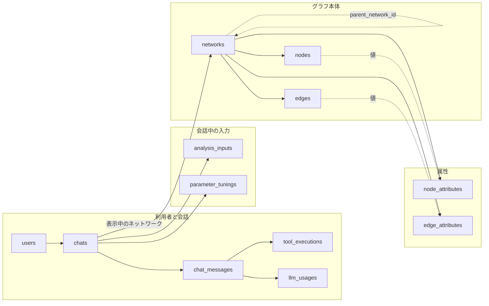
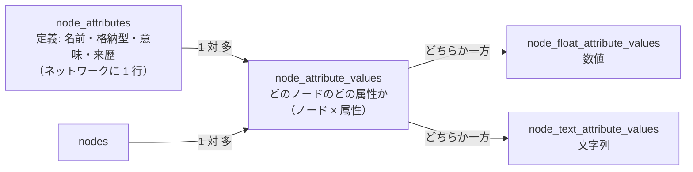
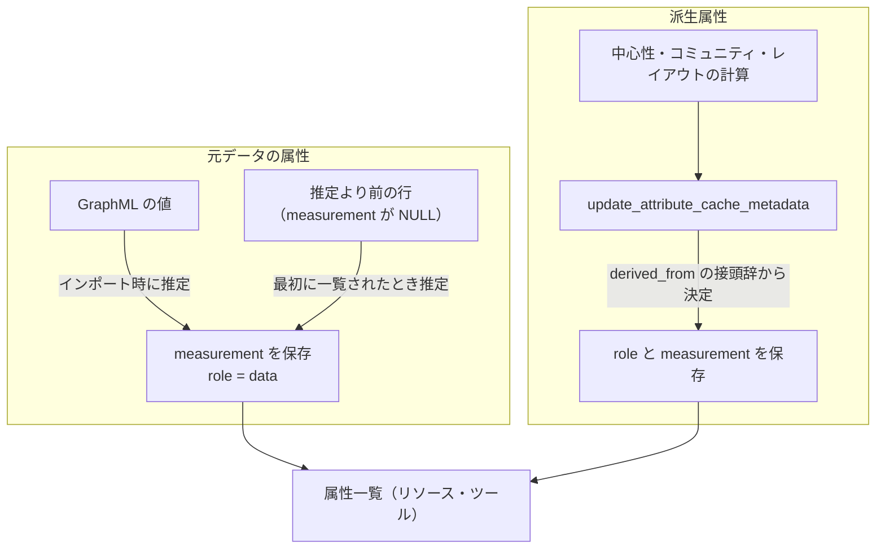
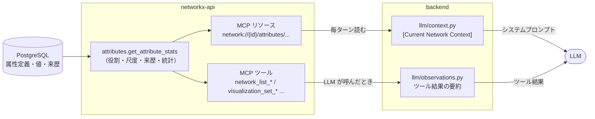

# 4. データベーススキーマ仕様

**前提知識レベル:**
- リレーショナルデータベースおよびSQLに関する基本的な知識
- ER図の読解能力

この文書は、データベースの**設計意図**を記録する。列の定義は記録しない。

| 知りたいこと | 見る場所 |
|---|---|
| テーブル・列・型・制約（全体） | [`common/schema.md`](../../common/schema.md)（`common/models.py` から生成した ER 図） |
| 列の正確な定義 | [`common/models.py`](../../common/models.py) |
| スキーマ変更の履歴 | `backend/alembic/versions/` |
| なぜその形なのか | この文書 |

列レベルの図を自動生成にした経緯は [ADR 0031](../4_Decisions/0031-generated-schema-diagram.md) を参照。

## 4.1. 設計方針

1. **ユーザーとチャット、ネットワークの関係**:
    ユーザーは複数のチャットを持つ。各チャットは、その時点で表示している 1 つのネットワークを指す（4.9）。

2. **ノードとエッジの明示的な管理**:
    アップロードされた GraphML は原文のまま保存せず、ノード・エッジ・属性に分解して格納する。

3. **属性の永続化と型別分離**:
    属性（元データ由来・計算結果のどちらも）は永続的なデータとして扱う。定義と値を分け、値は格納型ごとのテーブルに置く（4.4）。

4. **属性の意味を DB が持つ**:
    属性定義は、格納型のほかに、役割（なぜあるか）・尺度（値をどう比べられるか）・来歴（何からどう計算したか）を持つ。エージェントはこれを読んでエンコーディングを選ぶ（4.5、4.6）。

5. **エージェントの実行履歴の保存**:
    ツールの呼び出しと結果は、メッセージ本文とは独立したレコードとして保存する（4.10）。

6. **PostgreSQL を前提とする**:
    属性の一括登録は PostgreSQL の `INSERT ... ON CONFLICT` を使う。テストはインメモリの SQLite で走る（4.11）。

## 4.2. 全体像

テーブルは 4 つの領域に分かれる。列を含む図は [`common/schema.md`](../../common/schema.md) に領域ごとにある。下の図は領域どうしのつながりだけを描く。

`networks` と `chats` が 2 つの軸になっている。グラフ側のデータはすべて `networks` から、会話側のデータはすべて `chats` からたどれる。両者をつなぐのは `chats.network_id` の 1 本だけで、この参照は会話の中で移動する（4.9）。

## 4.3. 列定義について

**列定義は `common/models.py` が唯一の情報源である。** SQLAlchemy ORM が両サービスから共有されており、そこに書かれた型・制約・関連がそのまま実体である。

この文書に DDL や列つきの ER 図を手で転記していた時期は、実装との乖離が最も早く進んだ。ADR 0001 の整理の後も手書きの ER 図は残り、3 テーブルと来歴の列を欠いたまま放置されていた。現在の列レベルの図は生成物であり、古くなるとテストが落ちる。

列の意味を図に出したいときは、モデルの列に `comment=` を付ける。コメントは生成図と DB の両方に現れる。

## 4.4. 属性のサブタイプ階層

属性は「定義」と「値」を分け、値はさらに格納型ごとのテーブルに分離する。ノード側とエッジ側は同じ形をとる。

### 4.4.1. なぜ定義と値を分けるのか

属性の定義（名前・データ型・説明・役割・尺度・由来）はネットワークに 1 つだが、値はノードの数だけ存在する。分離することで、**エージェントは値を一切読まずに「どんな属性が使えるか」を把握できる。** 属性一覧のリソースが軽量であることは、システムプロンプトの文脈に含められるかどうかを左右する。

### 4.4.2. なぜ値を型別のテーブルに分けるのか

宣言された型と実際の格納先を分離することで、**インポート時の型不一致をエラーにせずに済む**。数値属性のはずの列に "N/A" が混入していても、その値はテキストとして保存され、データは失われない。

同時に、宣言された型と実際の格納テーブルを突き合わせれば、後から型不一致のデータを特定できる。**寛容にインポートし、厳密に検証する**という方針を、スキーマの形で表現したものである。

厳密な型を強制する設計を採らなかったのは、対象が研究者の手元にある実データだからである。取り込めないファイルがあることは、多少の型の揺れよりも重い問題になる。

### 4.4.3. `data_type` が意味を表さない理由

`data_type` は**どのテーブルに値があるか**を表し、それ以上のことは表さない。整数のグループ番号と中心性はどちらも `float` に、人名とクラブ名はどちらも `string` に格納される。エンコーディングの選択に必要な「値どうしをどう比べられるか」は、別の列 `measurement` が持つ（4.5）。格納の都合と意味を 1 つの列に兼ねさせないためである。

## 4.5. 属性の意味: 役割と尺度

属性定義は、格納型とは別に 2 つの意味を持つ。決定の経緯は [ADR 0030](../4_Decisions/0030-attribute-role-and-measurement.md) を参照。語彙の正は `networkx-api/app/logic/attribute_semantics.py` にある。

**役割（`role`）** は、属性がなぜ存在するかを表す。

| 役割 | 意味 | 例 |
|---|---|---|
| `data` | ファイルとともに取り込んだ | `club`, `birthYear` |
| `metric` | ここで計算した指標 | `degree_centrality`, `clustering` |
| `community` | ここで検出したコミュニティ | `louvain_community` |
| `coordinate` | レイアウトが保存した座標 | `forceatlas2_x` |

**尺度（`measurement`）** は、値どうしをどう比べられるかを表し、合うエンコーディングを決める。

| 尺度 | 値の性質 | 合うエンコーディング |
|---|---|---|
| `categorical` | 順序のないグループ | 色（`CATEGORICAL`） |
| `quantitative` | 差に意味がある量 | サイズ・太さ・色（`LINEAR` / `RANKING`） |
| `discrete` | 少数の整数。番号か個数かは値からは分からない | 名前と説明文から判断する |
| `identifier` | ほぼ要素ごとに異なる値 | ラベルのみ |
| `text` | 長い文章 | エンコードせず、読んで引用する |

### 4.5.1. 誰が決めるか

**派生属性の意味は、計算が知っている。** コミュニティの番号は順序を持たず、中心性は量である。これを値から推定し直す理由はないので、すべての派生属性が通る `update_attribute_cache_metadata` が、`derived_from` の接頭辞から 1 か所で決める。

**元データの尺度は推定であり、推定として扱う。** 推定は値だけを見る。郵便番号は量に見え、5 段階評定はグループに見えることがある。エージェントには、名前や説明文と食い違うときは意味を優先し、どちらで読んだかを利用者に伝えるよう指示している（`visual-encoding` スキル）。

### 4.5.2. `ordinal` を置かず `discrete` を置く理由

可視化で一般的な名義・順序・量の 3 分類のうち、順序尺度は値から推定できない。1〜5 の評定と 1〜5 のグループ番号は、値の上では同じである。推定できない値を列に書けば、正しいふりをした誤りになる。そこで曖昧さそのものを `discrete` と名付け、判断を、名前と説明文を読める LLM に委ねた。

### 4.5.3. 合わない対応付けを拒否しない理由

色・サイズ・太さのツールは、描いた尺度が `measurement` と合わないとき、戻り値に `encoding_note` を含める。拒否はしない。利用者が意図して珍しい対応付けを求めることがあり（ユーザー主権）、`discrete` はそもそも判定できないからである。警告なら、エージェントは同じ応答の中で直せる。

## 4.6. 派生属性のキャッシュと来歴

計算によって生成された属性（中心性、コミュニティ、レイアウト座標）は、元データ由来の属性と**同じテーブルに**格納する。ただし、派生であること・何から計算されたか・どのパラメータで計算されたか・計算時点のグラフ構造は、属性定義側に記録する。

### 4.6.1. 同じテーブルに置く理由

エージェントから見れば、「元データにあった `department`」と「計算した媒介中心性」は同じ *ノードの属性* であり、色やサイズに割り当てられる同じ種類のものである。格納場所を分けると、可視化ツールは両方を照会しなければならなくなり、その分岐が全ツールに波及する。区別は `role` と来歴の列が担う。

### 4.6.2. グラフ構造のハッシュを持つ理由

派生属性は入力となるグラフ構造に依存する。**サブグラフを作れば、同じ名前の中心性でも値は変わる。** 計算時のグラフ構造をハッシュとして保持することで、キャッシュが現在の構造に対して有効かどうかを判定できる。

パラメータも同様に記録するため、**異なるパラメータでの再計算は自動的にキャッシュミスになる**。明示的な再計算フラグは、利用者が「同じ条件でもう一度計算せよ」と求めた場合のためだけに存在する。

### 4.6.3. 来歴をエージェントに見せる理由

属性名からは、それが取り込んだものか計算したものかを判別できない（`club` は取り込んだもの、`louvain_community` は計算したもの）。区別できない読み手は、計算した値を記録された事実として報告してしまう。そのため来歴は、すべての属性一覧に `[derived: community:louvain; resolution=1.0]` の形で付く。パラメータは、キャッシュキーのうち人が読んで意味のあるもの（スカラー値）だけを見せる。

来歴の記録は 2026-07 に始まった。それ以前に計算された行は、計算が付ける名前（`{layout}_x`、`{algorithm}_community`）から判別し、マイグレーションで来歴を補った。

### 4.6.4. サブグラフへの複製で引き継ぐもの

サブグラフに属性を複製するとき、役割・尺度・来歴は引き継ぎ、グラフ構造のハッシュは引き継がない。値の意味は変わらないが、その値が有効だった構造はもう存在しないからである。派生属性は既定では複製しない。例外として、レイアウトを保つサブグラフは座標を複製し、その座標は `coordinate` のまま残る。

## 4.7. DB の情報が LLM に届く経路

**LLM は DB を直接読まない。** エージェントが DB について知ることは、次の経路を通ったものがすべてである。したがって「LLM が認識しやすい DB」とは、テーブルの形ではなく、DB が意味を持っていて、それがこの経路で欠けずに届くことを指す（ADR 0030）。

2 つの経路は性質が違う。

- **文脈（上の経路）** は毎ターン、LLM が何もしなくても届く。そのため短くなければならない。属性は `name (storage type, measurement)` の 1 行で示し、座標は属性一覧から外して `Computed layouts: ...` の 1 行にまとめる。座標を一覧に含めていた頃は、レイアウトを計算するたびに 2 行ずつ増え、15 件で打ち切る一覧から元データの属性を押し出していた。
- **ツール結果（下の経路）** は LLM が求めたときだけ届き、詳細を含められる。ただし大きさはネットワークの規模から切り離す（ADR 0024）。

この経路のどこかで意味が落ちると、DB に正しい値があってもエージェントには存在しないのと同じになる。リソースは例外を握り潰して空の結果に見せるため、実 DB に対する検査を置いている（[3_NetworkXAPI.md](./3_NetworkXAPI.md) 3.3.3）。

## 4.8. ネットワークの親子関係

ネットワークは自分自身への親参照を持ち、サブグラフは親を指す。**サブグラフは独立したネットワークとして格納され、親のノード・エッジを参照するのではなく複製する。**

**根拠**: サブグラフに対して計算された派生属性は、そのサブグラフの構造に対する値であり、親の同名属性とは別物である（4.6.2）。参照で表現すると、どちらの構造に対する値なのかを属性側で区別しなければならなくなる。複製のコストを払う代わりに、「1 つのネットワーク = 1 つの構造 = 1 組の属性」という単純な関係を保っている。

親をたどれる構造は、認可（[1_Backend.md](./1_Backend.md) 1.2.1）と、表示を親に戻す操作の双方で使われる。

## 4.9. チャットとネットワークの対応

チャットはネットワークと 1 対 1 で対応するが、この参照は**会話の中で移動する**。サブグラフを作れば参照はサブグラフを指し、親に戻れば巻き戻る。設計上の含意は [1_Backend.md](./1_Backend.md) 1.4.1 を参照。

## 4.10. ツール実行の記録

エージェントによるツール呼び出しは、メッセージとは独立したレコードとして保存する。呼び出し名・引数・結果・思考・状態・開始と終了の時刻を持つ。

**根拠**: これはエージェントの振る舞いを評価するための一次データである。メッセージ本文の表示形式が変わっても、この記録の形は変わってはならない。メッセージの拡張用メタデータに埋め込む設計を採らなかったのはこのためである。

## 4.11. データベースへの依存

本番と開発は PostgreSQL で動く。属性の一括登録（`ensure_attributes` など）は PostgreSQL 方言の `INSERT ... ON CONFLICT` と `RETURNING` を使い、同じ属性を二重に作らない。テストはインメモリの SQLite で走る。SQLite もこの 2 つの構文を受け付けるためである。

当初は SQLAlchemy を介して MySQL にも対応する方針だったが、上記の構文を使った時点でその方針は実質的に放棄されている。対応 RDBMS を増やす場合は、まずこの一括登録を方言ごとに分ける必要がある。

DDL はマイグレーション（Alembic）が生成する。この文書に手書きの `CREATE TABLE` を置かないのは、それが特定方言の写しにしかならないためでもある。
