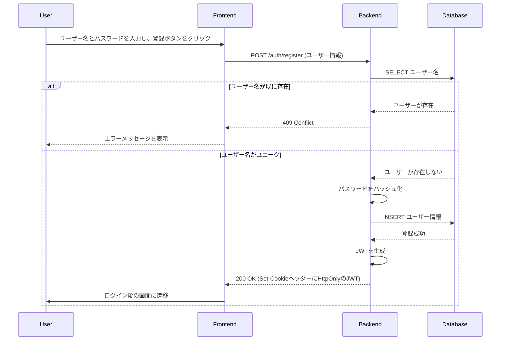
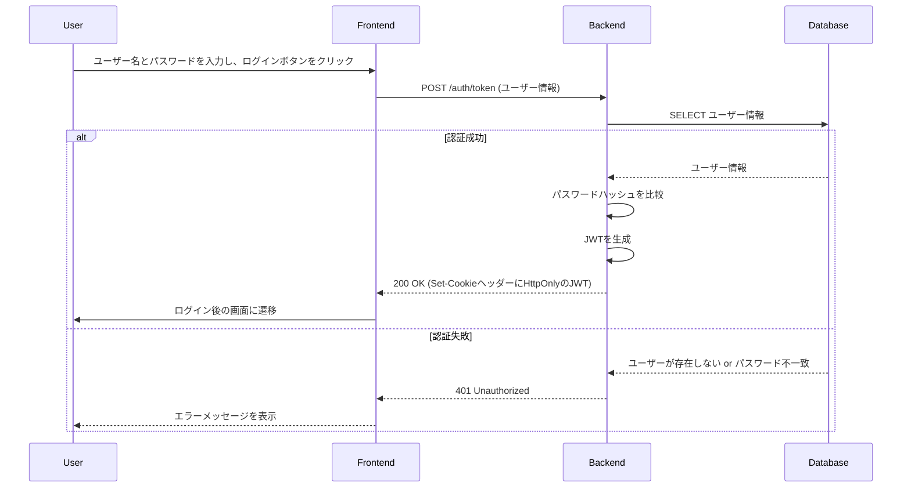
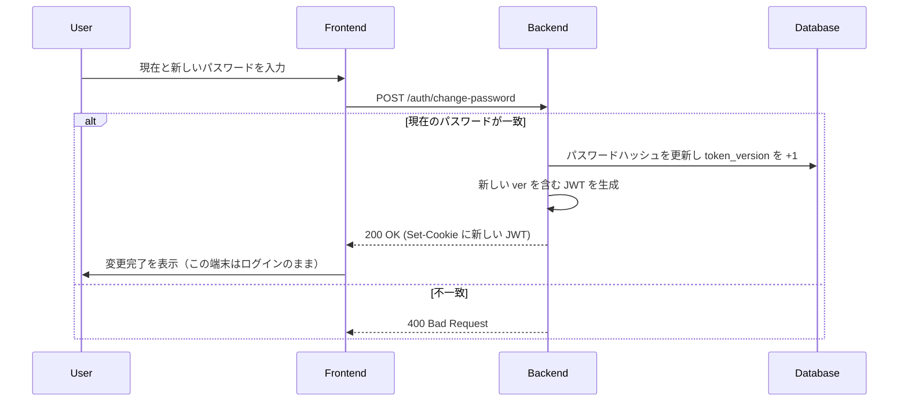

# 5. 認証フロー

**前提知識レベル:**
- OAuth2, JWTに関する基本的な知識
- シーケンス図の読解能力

**目的:** ユーザーが安全にシステムを利用するための、ユーザー登録およびログインのフローです。

認証後のデータ永続化やグラフ操作については、[6. 主要な処理フローとデータ生成](./6_Core_Workflows.md)を参照してください。

## 5.1. シーケンス図

### 5.1.1. 新規ユーザー登録フロー



### 5.1.2. ログインフロー



### 5.1.3. ログアウトフロー

```mermaid
sequenceDiagram
    participant User
    participant Frontend
    participant Backend

    User->>Frontend: ログアウトボタンをクリック
    Frontend->>Backend: POST /auth/logout
    Backend->>Backend: Cookie削除 (Set-Cookie: access_token=; Max-Age=0)
    Backend-->>Frontend: 200 OK
    Frontend->>User: ログイン画面に遷移
```

ログアウトは Cookie を消すだけである。Bearer トークンは期限かパスワード変更まで有効である。

### 5.1.4. パスワード変更フロー



## 5.2. トークンの版

JWT は `sub`（ユーザー名）と `ver`（発行時の `token_version`）を持つ。認証時に
`ver` がユーザーの現在の版と一致しなければ拒否する。パスワード変更で版を上げると、
それ以前に発行したトークンはすべて無効になり、他の端末はログアウトされる。
失効リストを持たずに済む代わりに、1 つのセッションだけを失効させることはできない。
`ver` のない旧トークンは版 0 とみなす（ADR [0026](../4_Decisions/0026-user-settings.md)）。
